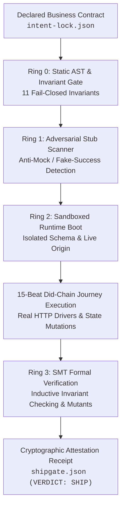

<div align="center">

# `ShipGate`
### Cryptographic Proof & Runtime Attestation Engine

**"We ship proof, not code. The product is the contract plus the attestation. The application is the byproduct."**

[](#-ring-3-formal-smt-verification--inductive-invariants)
[](#-the-four-verification-rings)
[](https://github.com/Ship-gate/zeta-benchmarks)
[](#)

</div>

---

### ⚡ The Problem & The Thesis

Consumer AI builders and "vibe-coding" tools emit unstructured code with no contract, no formal bounds, and no verification. They cannot produce proof. A gorgeous dashboard that silently leaks User A’s data to User B or returns mocked HTTP `200 OK` stubs is not an application—it is a critical liability.

**ShipGate is the independent attestation spine.**
Every system gets a contract. Every change gets proof. Every action gets an authority decision.



---

### 🛡️ The Four Verification Rings

```
┌─────────────────────────────────────────────────────────────────────────────┐
│ RING 0 │ STATIC AST & INVARIANT FIDELITY GATE                               │
│        │ Zero-leak credential audit, ghost-route detection, phantom deps,  │
│        │ and schema-to-route type alignment.                                │
├────────┼────────────────────────────────────────────────────────────────────┤
│ RING 1 │ ADVERSARIAL ANTI-STUB & ANTI-FAKE SCANNER                          │
│        │ Hard fail-closed on mocked return values, simulated successes,     │
│        │ hardcoded status codes, and empty action handler bodies.           │
├────────┼────────────────────────────────────────────────────────────────────┤
│ RING 2 │ 15-BEAT DID-CHAIN RUNTIME EXECUTION                                │
│        │ Provisions isolated database schemas, boots real HTTP endpoints,  │
│        │ and drives genuine browser journeys across the full user lifecycle.│
├────────┼────────────────────────────────────────────────────────────────────┤
│ RING 3 │ FORMAL SMT VERIFICATION & MUTANT TWINS                             │
│        │ Symbolic execution (Halmos/SMT). Every green proof must have a     │
│        │ broken mutant twin that is proven refuted to prevent vacuous passes│
└─────────────────────────────────────────────────────────────────────────────┘
```

#### 🔍 Ring 0: Static AST & Invariant Fidelity Gate
Before an artifact is permitted to boot, it must pass 11 fail-closed static checks:
- **Ghost Route Detection**: Ensures zero client-side RPC calls target nonexistent backend endpoints.
- **Phantom Dependency Audit**: Flags and halts on undeclared runtime imports or unpinned transitive trees.
- **Hardcoded Secret Scanners**: Real-time identification of tokens (`sk_live_`, private keys) prior to build lowering.
- **Contract-to-Schema Parity**: Formal verification that database migration tables match declared entity clauses.

#### 🚫 Ring 1: Adversarial Anti-Stub Scanner
AI emitters love to fake it. ShipGate refuses:
- Scans generated server actions, mutations, and database adapters for simulated data payloads.
- Flags and rejects `return { success: true }` blocks with no durable database mutation or side-effect record.
- Any surface that fakes core functionality forces an immediate `DECISION: NO_SHIP`.

#### 🚀 Ring 2: 15-Beat Did-Chain Runtime Verification
Proof requires live execution in isolated environments:
- Spins up an isolated, sandboxed PostgreSQL schema and boots the production Next.js / Node runtime.
- Drives 15 deterministic customer-journey beats (provision $\rightarrow$ invite $\rightarrow$ authenticate $\rightarrow$ mutate $\rightarrow$ query $\rightarrow$ audit $\rightarrow$ revoke).
- Observes durable database writes, cryptographic receipts, and real HTTP status codes.

#### 🧮 Ring 3: Formal SMT Verification & Mutant Twins
For mission-critical state transitions, token mechanics, and financial invariants:
- Executes symbolic bounded proofs with **Halmos** and SMT solvers.
- **The Cardinal Honesty Rule**: A proof is worthless without a refuted mutant twin. Every verified contract is paired with a deliberately compromised sibling. If the compromised twin does not fail, the proof is vacuous and execution FAILS CLOSED.

---

### 📜 The Cryptographic Attestation Receipt (`shipgate.json`)

When an application passes all verification rings, ShipGate emits a sealed cryptographic receipt:

```json
{
  "attestation_version": "2.4.0",
  "contract_hash": "sha256:4f89d31a89c02e5b7e8d64f0b3e7a91c890123456789abcdef",
  "verdict": "SHIP",
  "timestamp": "2026-10-07T14:23:00Z",
  "rings": {
    "ring_0_static_fidelity": {
      "status": "PASS",
      "invariants_checked": 11,
      "violations": 0
    },
    "ring_1_stub_scanner": {
      "status": "PASS",
      "mocked_surfaces_detected": 0,
      "fake_success_detected": 0
    },
    "ring_2_did_chain": {
      "status": "PASS",
      "beats_executed": 15,
      "durable_mutations_observed": 42,
      "schema_isolation_verified": true
    },
    "ring_3_formal_smt": {
      "status": "PASS",
      "symbolic_invariants_proven": 8,
      "refuted_mutant_twins": 8,
      "vacuous_passes": 0
    }
  },
  "signature": "ed25519:9a8b7c6d5e4f3a2b1c0d9e8f7a6b5c4d3e2f1a0b..."
}
```

---

### 📊 Public Reproducibility & Open Benchmarks

We publish our benchmark harnesses and verification suites openly:

* **[`Ship-gate/zeta-benchmarks`](https://github.com/Ship-gate/zeta-benchmarks)**:
  - **Halmos SMT Suites**: Inductive invariant proofs and non-vacuous mutant counterexamples.
  - **Safety Corpus**: Planted-defect detection suite (`ghost-route`, `hardcoded-secret`, `phantom-dep`, `missing-truthpack`).
  - **Reproducibility Harness**: Complete instructions for Foundry, Halmos 0.3.3, and solc 0.8.20.
  - **Cost & Throughput Ledgers**: Per-app token accounting and performance benchmarks.

---

### 🌐 Tooling & Ecosystem

| System | Role | Invariant |
| :--- | :--- | :--- |
| **ShipGate** | Attestation & Runtime Proof Engine | Verifies software execution against declared contracts. |
| **Claude Conscious** | Agent Procedural Memory | Persistent cross-session state & reflex caching for Claude Code. |
| **VibeCheck** | Hallucination Prevention Platform | Real-time perception taint evaluation and behavioral circuit breakers. |
| **ISL** | Intent Specification Language | Formal closed-world AST for enterprise invariants and state machines. |

---

<div align="center">

**[Documentation](https://shipgate.dev)** • **[Benchmarks](https://github.com/Ship-gate/zeta-benchmarks)** • **[VibeCheck](https://vibecheckai.dev)**

*Agents decide what they want to do. ShipGate decides what they have the authority to do.*

</div>
